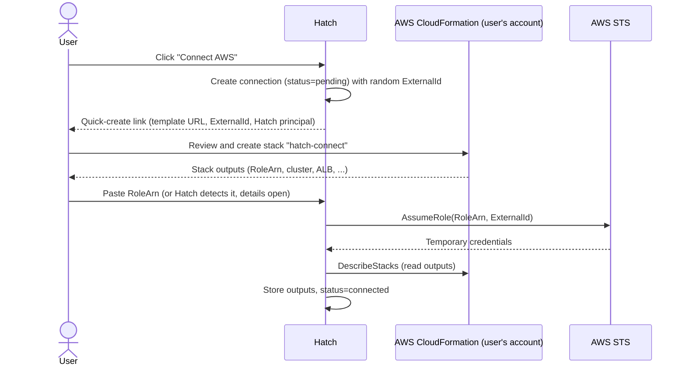
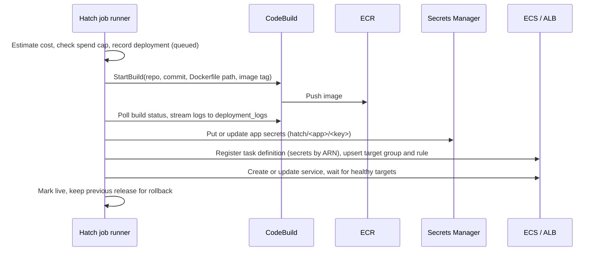

# Target Architecture

Status: **agreed direction, details open.** Items marked _(open)_ are listed in
[Open questions](06-open-questions.md) and will be settled before the phase
that needs them.

## Overview

Hatch splits into two planes:

- **Control plane:** a small Hatch installation: one Go program (which also
  serves the web UI) and Postgres. It stores users, projects, and connections, and orchestrates
  work. It never runs user code.
- **Data plane:** where builds and apps actually run. Either the **user's AWS
  account** (the product) or the **local Docker** host (development and small
  self-hosted setups).

```
                 Hatch control plane
   ┌──────────────────────────────────────────────────┐
   │  hatch (one Go program)                          │
   │    ├─ Web UI (React, embedded) + HTTP API        │
   │    ├─ Live logs (server-sent events)             │
   │    ├─ Job runner (build, deploy, cleanup, sweep) │
   │    └─ Providers: build + runtime + cost          │
   │  PostgreSQL (data, jobs, logs)                   │
   └───────────────┬──────────────────────────────────┘
                   │ sts:AssumeRole (with ExternalId)
                   ▼
         User's AWS account (their bill)
   ┌──────────────────────────────────────────────────┐
   │  CloudFormation stack "hatch-connect"            │
   │    IAM role for Hatch · VPC · ECS cluster        │
   │    ALB + HTTPS · ECR repo · CodeBuild project    │
   │    CloudWatch log group · AWS Budget alarm       │
   │  Per app: ECS service, task definition,          │
   │    target group, listener rule, secrets, images  │
   └──────────────────────────────────────────────────┘

   Local target: Docker on the Hatch host + a reverse proxy for *.localhost
```

## Principles

1. **User code never runs on the control plane.** On AWS, builds run in
   CodeBuild in the user's account. On the local target the user and operator
   are the same person, so building on the host is acceptable.
2. **Least privilege, scoped to Hatch's own resources.** The connected role can
   only touch resources Hatch created (name prefix `hatch-` and tag
   `hatch:managed=true`), plus the reads it needs.
3. **Everything Hatch creates is recorded.** Each cloud resource is written to
   an inventory table before or as it is created, so it can be shown, costed,
   and destroyed.
4. **Durable, retryable jobs.** Every cloud operation is an idempotent job in
   Postgres. A crash or restart resumes or safely retries it.
5. **Few moving parts.** One program, one database. No message broker, no
   cache server.
6. **Develop and test without AWS.** Every AWS interaction sits behind an
   interface with a fake implementation and the local Docker implementation.

## Components

### `hatch` program

One Go binary with subcommands:

- `hatch serve`: the web UI, HTTP API, live log streaming, and the job runner
  in one process (the default for small installs).
- `hatch worker`: job runner only, for running workers separately later.
- `hatch migrate`: apply database migrations.

Internal modules keep the old service boundaries as packages, so any one of
them could become a separate service later if there is a real reason. The
full repository layout, and how today's files map onto it, is in
[ADR 0008](decisions/0008-repository-structure.md):

```
cmd/hatch/            entry point and subcommands
internal/api/         HTTP handlers, auth, sessions, CSRF
internal/stream/      deployment log streaming (Postgres LISTEN/NOTIFY → server-sent events)
internal/jobs/        job definitions and workers (River)
internal/build/       Builder interface; codebuild/, docker/, fake/ implementations
internal/runtime/     Runtime interface; ecs/, docker/, fake/ implementations
internal/cloud/aws/   STS assume-role, connection verification
internal/cost/        cost estimation and spend tracking
internal/inventory/   resource inventory and teardown
internal/github/      GitHub App: sign-in, installation tokens, webhooks
internal/secrets/     encryption at rest (existing codec)
internal/config/      environment configuration
internal/store/       sqlc queries (pgx) and embedded migrations
web/                  React + Vite app; embed.go embeds the build into the binary
deploy/cloudformation/hatch-connect.yaml
```

### Providers

Build and runtime are separate interfaces, so they can be mixed and faked in
tests. Sketch _(signatures will change during implementation)_:

As built (`internal/build`, `internal/runtime`, `internal/cost`). Each is
created with the `stream.Sink` its progress goes to, and cancellation is the
context: the job cancels it when the deployment is canceled.

```go
type Builder interface {
    // Build clones, builds and pushes, and returns the image.
    Build(ctx context.Context, spec Spec) (Image, error)
    DeleteImages(ctx context.Context, images []Image) error
}

type Runtime interface {
    // canceled is checked between steps; true stops the deploy with ErrCanceled.
    Deploy(ctx context.Context, spec DeploySpec, canceled func(context.Context) (bool, error)) (Release, error)
    Scale(ctx context.Context, app AppRef, replicas int32) error
    Destroy(ctx context.Context, app AppRef) error
    // RuntimeLogs(...) arrives with the runtime log viewer.
}

type Estimator interface { // package cost
    Estimate(ctx context.Context, spec runtime.DeploySpec) (Monthly, error)
}
```

`build/docker` (Docker on the host, pushing to ECR) and `runtime/ecs` implement
the first two today; each package `fake` is used in tests. `cost` has an
interface and a fake only; nothing calls it until Phase 4.

| Provider | Builder | Runtime | Routing |
|----------|---------|---------|---------|
| `local` | `docker build` on the host | Docker containers | Built-in proxy, `<app>.localhost` ([0018](decisions/0018-built-in-proxy-for-the-local-target.md)) |
| `aws` | CodeBuild in the user's account → ECR | ECS Fargate | Shared ALB in the user's account, HTTPS via ACM |
| `fake` | In-memory, scripted outcomes | In-memory | — (used in tests) |

### Job system

Replaces RabbitMQ. Jobs live in Postgres and run on
[River](https://riverqueue.com) ([ADR 0011](decisions/0011-river-and-pgx.md)),
which claims them with `SELECT … FOR UPDATE SKIP LOCKED` and provides retries,
scheduling, and unique jobs. Jobs are enqueued in the same transaction as the
change that causes them.

| Job | Trigger | Does |
|-----|---------|------|
| `build` | Deploy requested | Run the Builder, enqueue `deploy` and finish in one transaction |
| `deploy` | Build finished | Run the Runtime, wait for health, mark live, retire the previous release |
| `scale` | Pause, resume, idle policy | Set replicas |
| `destroy_app` | Project deleted, expiry reached | Remove all inventory rows for the app |
| `destroy_account` | "Tear down everything" | Remove all inventory rows for the connected account |
| `verify_connection` | Account connected, periodically | Assume the role and check the stack |
| `sweep` | Scheduled | Find orphaned or failed resources, apply idle and expiry policies, refresh cost data |

Rules: each job is idempotent; each step checks inventory before creating
anything; retries use backoff; a job records its last error for the UI;
cancellation is a flag the job checks between steps (as today).

### Log streaming

Built ([ADR 0012](decisions/0012-server-sent-events-for-logs.md)); Redis is gone.
Build and deploy log lines are inserted into `deployment_logs` (deployment id,
`seq`, line). `seq` counts from 1 within the deployment: the writer bumps
`deployments.log_seq` and inserts in one statement, so writers of the same
deployment are serialised and lines are numbered and committed in order. A
deployment keeps at most 20,000 lines (the last says the log was cut) and a
line at most 8 KB. A daily job deletes a finished deployment's lines 30 days
after it was created, except for the newest five deployments of each project.

Triggers `NOTIFY deployment_events` with just the deployment id when a line is
added or a status changes. The API holds one connection that `LISTEN`s
(`stream.Broker`) and wakes the streams watching that deployment, which then
read what they missed from the tables: a notification is only a hint, so a lost
one cannot lose a line, and each stream also looks at the database every few
seconds. Writers can be another process (`hatch worker`) from the one serving
the browser.

`GET /api/deployments/{id}/logs/stream` sends server-sent events: `log` (its
`id` is the line's `seq`), `status` (when the stream starts and each time it
changes), and `end` once the deployment has a final status and every line has
been sent. A reconnecting browser sends `Last-Event-ID` and gets only what
followed. The stream lifts the server's 30-second write timeout for itself and
ends when Hatch shuts down. A finished deployment's whole log is read the same
way. `GET /api/deployments/{id}/logs?tail=N` returns the last N lines as JSON.

Not built yet: pruning old logs. They are removed only with their deployment.

Runtime (application) logs on AWS are read on demand from CloudWatch Logs
through the assumed role; on the local target, from Docker.

## Connecting an AWS account



- The **ExternalId** prevents the confused-deputy problem: another Hatch user
  cannot make Hatch assume a role they do not own.
- Hatch stores only the role ARN, ExternalId, region, and stack outputs. It
  never stores long-lived AWS keys.
- The stack template is versioned. Hatch checks the deployed version and
  prompts for a stack update when the template changes.
- **Region:** one region per connection in v1.

### What the `hatch-connect` stack creates

| Resource | Notes |
|----------|-------|
| IAM role `hatch-control` | Trusts the configured Hatch principal ([0020](decisions/0020-the-connection-role-trusts-a-configured-principal.md)) with the ExternalId condition. Policy limited to `hatch-` resources and required reads. |
| IAM role `hatch-task-execution` | Used by ECS to pull images and read app secrets. |
| IAM role `hatch-codebuild` | Used by CodeBuild to pull source and push to ECR. |
| VPC, 2 public subnets, security groups | App security group accepts traffic only from the ALB. |
| ECS cluster `hatch` | Fargate only. |
| ALB with HTTP→HTTPS redirect | Certificate is optional at connect time; without one, apps use HTTP on the ALB hostname ([0021](decisions/0021-http-only-without-a-domain.md)). |
| ECR repository `hatch-apps` | Lifecycle policy expires untagged and old images. |
| CodeBuild project `hatch-build` | Privileged mode for Docker builds; per-build source and image passed as overrides. |
| CloudWatch log group `/hatch/apps` | Retention set (for example 14 days) so logs do not grow forever. |
| AWS Budget | Monthly limit chosen by the user, with email alerts at 50%, 80%, and 100%. |

The ALB and its hourly charge are the fixed cost of a connected account. Hatch
states this before the user creates the stack.

## Deploy flow (AWS)



### Source access for builds

CodeBuild fetches the repository with a GitHub App installation token scoped
to that one repository and valid for an hour
([ADR 0010](decisions/0010-github-app.md)). The token must never appear in
build logs or be stored in the user's account longer than the build.

### Secrets

User env vars marked secret are written to Secrets Manager in the user's
account and referenced from the task definition's `secrets` field, so they
never appear in plain text in ECS. Non-secret env vars can stay as plain
`environment` values. The control plane keeps encrypted copies only as needed
to re-sync _(whether to keep them at all is open)_.

### Rollback

Every deploy produces an immutable image tag (the deployment ID) and a task
definition revision. Rollback is a `deploy` job that reuses a previous
release's image and env snapshot without rebuilding.

## Security model

| Threat | Mitigation |
|--------|-----------|
| Malicious Dockerfile attacks Hatch | Builds never run on the control plane (AWS); local target is single-tenant by design |
| One Hatch user assumes another's role | ExternalId per connection; role ownership checked on every job |
| Leaked control-plane database | No long-lived AWS keys stored; GitHub tokens and secrets encrypted at rest; app secrets live in the user's account |
| Overly broad AWS permissions | Role policy scoped by `hatch-` prefix and `hatch:managed` tag; no IAM write except passing the two Hatch roles |
| Over-broad GitHub access | GitHub App installed per repository, read-only, short-lived tokens ([0010](decisions/0010-github-app.md)) |
| Stolen session | Server-side sessions in Postgres that can be revoked; only hashed IDs stored ([0013](decisions/0013-server-side-sessions.md)) |
| Surprise cost | See [Cost guardrails](04-cost-guardrails.md) |

## Data model changes

New or changed tables (names provisional):

- `cloud_connections`: user, provider (`aws` or `local`), AWS account ID,
  region, role ARN, ExternalId, stack name and version, stack outputs, status,
  monthly budget, last verified time.
- `projects`: add `connection_id`, `expires_at`, `idle_policy`,
  `last_request_at`, and `service_type` (only `web` in v1; workers and cron
  jobs come after v1, see [ADR 0015](decisions/0015-v1-runs-web-services-only.md)).
- `deployments`: add `image_digest`, `rollback_of`, `estimated_monthly_cost`;
  add status `superseded` for releases replaced by a newer live one.
- `resources`: the inventory. Connection, project (nullable), type (for example
  `ecs_service`, `target_group`, `listener_rule`, `task_definition`,
  `ecr_image`, `secret`), cloud identifier (ARN), state, created and deleted
  times.
- `deployment_logs`: deployment, sequence, line, created time.
- River's own tables (`river_job` and related), created by its migrations.
- `sessions`: user, SHA-256 hash of the session ID, created, last seen, and
  expiry times.
- `github_installations`: installation ID, account, owning user; replaces the
  stored OAuth token. (The per-project `webhook_secret` and `webhook_id` are gone:
  pushes arrive through the App's own webhook, ADR 0010.)
- v1 is single-user: each user owns their own connections and projects, but
  ownership columns are named so an organization owner can be added later.
- `env_vars` and `project_env_vars`: mark each variable as secret or plain;
  secret values point to a Secrets Manager ARN instead of the unused
  `secret_arn` column carrying no meaning today.

## Local target details

- Builds: `docker build` against the cloned repo on the Hatch host
  (`build/docker`, local mode). The image stays in the host's Docker as
  `hatch-local:<deployment id>`; nothing is pushed.
- Runtime: one container per app (`runtime/docker`) on a dedicated Docker
  network, with a restart policy, CPU and memory limits, and its port published
  on 127.0.0.1. A deploy starts the new container beside the old one, waits for
  its health check, then removes the old one; a failed or canceled deploy
  removes only what it started. Containers carry `hatch.*` labels, and Docker is
  the source of truth for what runs where.
- Routing: a reverse proxy built into `hatch serve` routes
  `<app>.localhost:8081` to the container, finding it through Docker
  ([0018](decisions/0018-built-in-proxy-for-the-local-target.md)). Browsers
  resolve `*.localhost` to 127.0.0.1, so no DNS setup is needed for
  development.
- Project icons: `GET /api/projects/:id/icon` fetches the favicon the running
  app declares (its `<link rel="icon">`, then `/favicon.ico`), only from the app
  itself, and the console falls back to Hatch's mark when there is none.
- Project addresses: subdomains are unique across all accounts, so the
  new-project page asks `GET /api/subdomains/:name` whether one is free (or
  reserved, or malformed) before the user fills in the rest. Creating the
  project still has the last word.
- Traffic: the proxy counts requests per app for the last hour (in memory) and
  the API serves them at `GET /api/traffic`, so the console shows traffic with
  no extra component ([0018](decisions/0018-built-in-proxy-for-the-local-target.md#traffic-counts-added-2026-10-22)).
- Cost estimate: shows `$0 (local)`; guardrails such as expiry and idle pause
  still apply, so the flow is identical to AWS.

## Technology stack

| Layer | Choice | Status |
|-------|--------|--------|
| Language (backend) | Go | Keep |
| HTTP router | Gin | Keep |
| Database | PostgreSQL 18 | Upgraded from 16 before any data existed |
| Postgres driver | pgx v5 + pgxpool | Decided ([0011](decisions/0011-river-and-pgx.md)), replaces `lib/pq` |
| Queries and migrations | sqlc + golang-migrate (embedded in the binary) | Keep |
| Job queue | River on Postgres | Decided ([0011](decisions/0011-river-and-pgx.md)) |
| Live logs | Postgres `LISTEN/NOTIFY` + server-sent events | Decided ([0012](decisions/0012-server-sent-events-for-logs.md)) |
| Sessions | Server-side, in Postgres | Decided ([0013](decisions/0013-server-side-sessions.md)) |
| Logging | `log/slog`, JSON in production | Decided |
| GitHub integration | GitHub App | Decided ([0010](decisions/0010-github-app.md)) |
| Frontend | React + Vite + TypeScript, React Router, TanStack Query, Tailwind 4; embedded in the Go binary | Built ([0009](decisions/0009-react-spa-served-by-go.md)) |
| Web package manager | pnpm, pinned to 10.x | Decided ([0016](decisions/0016-pnpm-for-the-web-app.md)) |
| AWS SDK | aws-sdk-go-v2 | Keep |
| AWS builds | CodeBuild | Decided |
| AWS runtime | ECS Fargate + ALB | Keep |
| AWS secrets | Secrets Manager | Decided |
| Account connection | CloudFormation quick-create + STS AssumeRole with ExternalId | Decided |
| Local proxy | Built-in reverse proxy in `hatch serve`; Caddy later ([0018](decisions/0018-built-in-proxy-for-the-local-target.md)) | Decided |
| Tests | Go tests against a real Postgres (Docker locally, a service container in CI); fakes for cloud providers | Decided |
| CI | GitHub Actions | In place |
