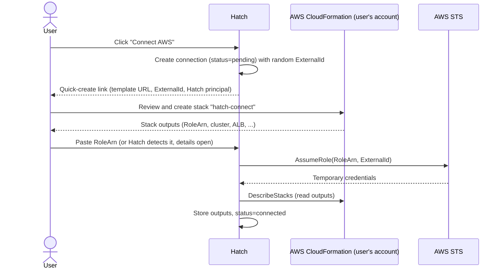
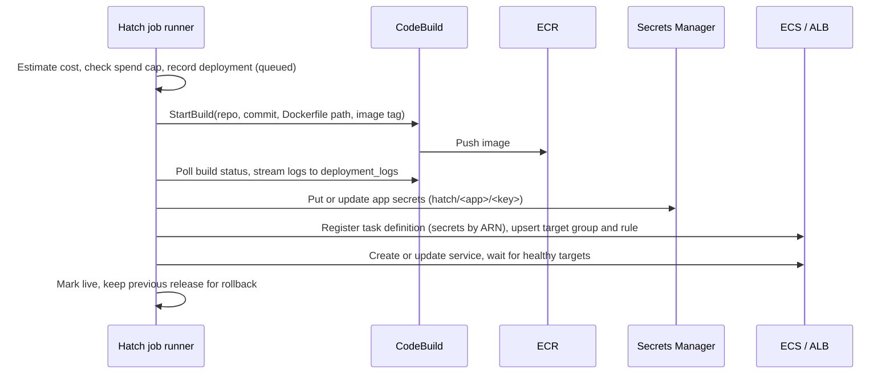

# Target Architecture

Status: **agreed direction, details open.** Items marked _(open)_ are listed in
[Open questions](06-open-questions.md) and will be settled before the phase
that needs them.

## Overview

Hatch splits into two planes:

- **Control plane:** a small Hatch installation (one Go program, Postgres, and
  the web UI). It stores users, projects, and connections, and orchestrates
  work. It never runs user code.
- **Data plane:** where builds and apps actually run. Either the **user's AWS
  account** (the product) or the **local Docker** host (development and small
  self-hosted setups).

```
                 Hatch control plane
   ┌──────────────────────────────────────────────────┐
   │  Web UI (Next.js)                                │
   │  hatch (one Go program)                          │
   │    ├─ HTTP API + WebSocket log stream            │
   │    ├─ Job runner (build, deploy, cleanup, sweep) │
   │    └─ Providers: build + runtime + cost          │
   │  PostgreSQL (data, jobs, logs)                   │
   └───────────────┬──────────────────────────────────┘
                   │ sts:AssumeRole (with ExternalId)
                   ▼
         User's AWS account (their bill)
   ┌──────────────────────────────────────────────────┐
   │  CloudFormation stack "hatch-connect"            │
   │    IAM role for Hatch · VPC · ECS cluster        │
   │    ALB + HTTPS · ECR repo · CodeBuild project    │
   │    CloudWatch log group · AWS Budget alarm       │
   │  Per app: ECS service, task definition,          │
   │    target group, listener rule, secrets, images  │
   └──────────────────────────────────────────────────┘

   Local target: Docker on the Hatch host + a reverse proxy for *.localhost
```

## Principles

1. **User code never runs on the control plane.** On AWS, builds run in
   CodeBuild in the user's account. On the local target the user and operator
   are the same person, so building on the host is acceptable.
2. **Least privilege, scoped to Hatch's own resources.** The connected role can
   only touch resources Hatch created (name prefix `hatch-` and tag
   `hatch:managed=true`), plus the reads it needs.
3. **Everything Hatch creates is recorded.** Each cloud resource is written to
   an inventory table before or as it is created, so it can be shown, costed,
   and destroyed.
4. **Durable, retryable jobs.** Every cloud operation is an idempotent job in
   Postgres. A crash or restart resumes or safely retries it.
5. **Few moving parts.** One program, one database. No message broker, no
   cache server.
6. **Develop and test without AWS.** Every AWS interaction sits behind an
   interface with a fake implementation and the local Docker implementation.

## Components

### `hatch` program

One Go binary with subcommands _(exact layout open)_:

- `hatch serve`: HTTP API, WebSocket log streaming, and the job runner in one
  process (the default for small installs).
- `hatch worker`: job runner only, for running workers separately later.
- `hatch migrate`: apply database migrations.

Internal modules keep the old service boundaries as packages, so any one of
them could become a separate service later if there is a real reason:

```
cmd/hatch/            entry point and subcommands
internal/api/         HTTP handlers, auth, sessions, CSRF
internal/stream/      deployment log streaming (Postgres LISTEN/NOTIFY → WebSocket)
internal/jobs/        job definitions, runner, retries, scheduling
internal/build/       Builder interface; codebuild/ and docker/ implementations
internal/runtime/     Runtime interface; ecs/ and docker/ implementations
internal/cloud/aws/   STS assume-role, connection verification, CloudFormation template
internal/cost/        cost estimation and spend tracking
internal/inventory/   resource inventory and teardown
internal/github/      OAuth or GitHub App, repos, webhooks
internal/secrets/     encryption at rest (existing codec)
internal/store/       sqlc queries and migrations
web/                  Next.js app
deploy/cloudformation/hatch-connect.yaml
```

### Providers

Build and runtime are separate interfaces, so they can be mixed and faked in
tests. Sketch _(signatures will change during implementation)_:

```go
type Builder interface {
    // Build turns a source revision into an image reference, streaming logs.
    Build(ctx context.Context, spec BuildSpec, logs LogSink) (Image, error)
    Cancel(ctx context.Context, buildID string) error
}

type Runtime interface {
    Deploy(ctx context.Context, spec DeploySpec, logs LogSink) (Release, error)
    Scale(ctx context.Context, app AppRef, replicas int) error
    Destroy(ctx context.Context, app AppRef) error
    RuntimeLogs(ctx context.Context, app AppRef, q LogQuery) (LogPage, error)
}

type CostEstimator interface {
    Estimate(ctx context.Context, spec DeploySpec) (MonthlyCost, error)
}
```

| Provider | Builder | Runtime | Routing |
|----------|---------|---------|---------|
| `local` | `docker build` on the host | Docker containers | Reverse proxy, `<app>.localhost` _(proxy choice open)_ |
| `aws` | CodeBuild in the user's account → ECR | ECS Fargate | Shared ALB in the user's account, HTTPS via ACM |
| `fake` | In-memory, scripted outcomes | In-memory | — (used in tests) |

### Job system

Replaces RabbitMQ. Jobs live in Postgres and are claimed with
`SELECT … FOR UPDATE SKIP LOCKED` _(library vs hand-rolled is open; River is
the main candidate)_.

| Job | Trigger | Does |
|-----|---------|------|
| `build` | Deploy requested | Run the Builder, record the image, enqueue `deploy` |
| `deploy` | Build finished | Run the Runtime, wait for health, mark live, retire the previous release |
| `scale` | Pause, resume, idle policy | Set replicas |
| `destroy_app` | Project deleted, expiry reached | Remove all inventory rows for the app |
| `destroy_account` | "Tear down everything" | Remove all inventory rows for the connected account |
| `verify_connection` | Account connected, periodically | Assume the role and check the stack |
| `sweep` | Scheduled | Find orphaned or failed resources, apply idle and expiry policies, refresh cost data |

Rules: each job is idempotent; each step checks inventory before creating
anything; retries use backoff; a job records its last error for the UI;
cancellation is a flag the job checks between steps (as today).

### Log streaming

Replaces Redis. Build and deploy log lines are inserted into a
`deployment_logs` table (deployment ID, sequence number, line). After insert,
Hatch sends `NOTIFY deployment_logs, '<deployment_id>:<seq>'`. The WebSocket
handler sends history from the table first, then live lines as notifications
arrive. Payloads stay small because the line is read from the table, not sent
through `NOTIFY` (Postgres limits `NOTIFY` payloads to 8,000 bytes). Old log
rows are pruned on a schedule.

Runtime (application) logs on AWS are read on demand from CloudWatch Logs
through the assumed role; on the local target, from Docker.

## Connecting an AWS account



- The **ExternalId** prevents the confused-deputy problem: another Hatch user
  cannot make Hatch assume a role they do not own.
- Hatch stores only the role ARN, ExternalId, region, and stack outputs. It
  never stores long-lived AWS keys.
- The stack template is versioned. Hatch checks the deployed version and
  prompts for a stack update when the template changes.
- **Region:** one region per connection in v1.

### What the `hatch-connect` stack creates

| Resource | Notes |
|----------|-------|
| IAM role `hatch-control` | Trusts Hatch's principal with the ExternalId condition. Policy limited to `hatch-` resources and required reads. |
| IAM role `hatch-task-execution` | Used by ECS to pull images and read app secrets. |
| IAM role `hatch-codebuild` | Used by CodeBuild to pull source and push to ECR. |
| VPC, 2 public subnets, security groups | App security group accepts traffic only from the ALB. |
| ECS cluster `hatch` | Fargate only. |
| ALB with HTTP→HTTPS redirect | Certificate is optional at connect time; without one, apps use HTTP on the ALB hostname _(open)_. |
| ECR repository `hatch-apps` | Lifecycle policy expires untagged and old images. |
| CodeBuild project `hatch-build` | Privileged mode for Docker builds; per-build source and image passed as overrides. |
| CloudWatch log group `/hatch/apps` | Retention set (for example 14 days) so logs do not grow forever. |
| AWS Budget | Monthly limit chosen by the user, with email alerts at 50%, 80%, and 100%. |

The ALB and its hourly charge are the fixed cost of a connected account. Hatch
states this before the user creates the stack.

## Deploy flow (AWS)



### Source access for builds

CodeBuild needs to fetch the repository. Options _(open)_: pass a short-lived
GitHub token per build (with a GitHub App, an installation token that expires
within an hour), or have Hatch upload a source archive to S3 in the user's
account. The token must never appear in build logs or be stored in the user's
account longer than the build.

### Secrets

User env vars marked secret are written to Secrets Manager in the user's
account and referenced from the task definition's `secrets` field, so they
never appear in plain text in ECS. Non-secret env vars can stay as plain
`environment` values. The control plane keeps encrypted copies only as needed
to re-sync _(whether to keep them at all is open)_.

### Rollback

Every deploy produces an immutable image tag (the deployment ID) and a task
definition revision. Rollback is a `deploy` job that reuses a previous
release's image and env snapshot without rebuilding.

## Security model

| Threat | Mitigation |
|--------|-----------|
| Malicious Dockerfile attacks Hatch | Builds never run on the control plane (AWS); local target is single-tenant by design |
| One Hatch user assumes another's role | ExternalId per connection; role ownership checked on every job |
| Leaked control-plane database | No long-lived AWS keys stored; GitHub tokens and secrets encrypted at rest; app secrets live in the user's account |
| Overly broad AWS permissions | Role policy scoped by `hatch-` prefix and `hatch:managed` tag; no IAM write except passing the two Hatch roles |
| Over-broad GitHub access | Move to a GitHub App with per-repository installation _(open)_ |
| Stolen session | Server-side sessions in Postgres so they can be revoked _(open)_ |
| Surprise cost | See [Cost guardrails](04-cost-guardrails.md) |

## Data model changes

New or changed tables (names provisional):

- `cloud_connections`: user, provider (`aws` or `local`), AWS account ID,
  region, role ARN, ExternalId, stack name and version, stack outputs, status,
  monthly budget, last verified time.
- `projects`: add `connection_id`, `expires_at`, `idle_policy`,
  `last_request_at`.
- `deployments`: add `image_digest`, `rollback_of`, `estimated_monthly_cost`;
  add status `superseded` for releases replaced by a newer live one.
- `resources`: the inventory. Connection, project (nullable), type (for example
  `ecs_service`, `target_group`, `listener_rule`, `task_definition`,
  `ecr_image`, `secret`), cloud identifier (ARN), state, created and deleted
  times.
- `deployment_logs`: deployment, sequence, line, created time.
- `jobs`: if the job queue is hand-rolled (a library such as River brings its
  own tables).
- `sessions`: if server-side sessions are adopted.
- `env_vars` and `project_env_vars`: mark each variable as secret or plain;
  secret values point to a Secrets Manager ARN instead of the unused
  `secret_arn` column carrying no meaning today.

## Local target details

- Builds: `docker build` against the cloned repo on the Hatch host.
- Runtime: one container per app on a dedicated Docker network, with a restart
  policy.
- Routing: a reverse proxy routes `<app>.localhost` to the container. Browsers
  resolve `*.localhost` to 127.0.0.1, so no DNS setup is needed for
  development.
- Cost estimate: shows `$0 (local)`; guardrails such as expiry and idle pause
  still apply, so the flow is identical to AWS.

## Technology stack

| Layer | Choice | Status |
|-------|--------|--------|
| Language (backend) | Go | Keep |
| HTTP router | Gin | Keep for now _(open: stdlib `net/http` routing)_ |
| Database | PostgreSQL 16 | Keep |
| Queries and migrations | sqlc + golang-migrate | Keep |
| Job queue | Postgres (`SKIP LOCKED`) | Decided; library _(open)_ |
| Log streaming | Postgres `LISTEN/NOTIFY` + WebSocket | Decided |
| AWS SDK | aws-sdk-go-v2 | Keep |
| AWS builds | CodeBuild | Decided |
| AWS runtime | ECS Fargate + ALB | Keep |
| AWS secrets | Secrets Manager | Decided |
| Account connection | CloudFormation quick-create + STS AssumeRole with ExternalId | Decided |
| Frontend | Next.js + React + Tailwind | Keep _(open: component restructuring)_ |
| GitHub integration | OAuth App today | _(open: GitHub App)_ |
| Local proxy | — | _(open: Caddy or Traefik)_ |
| CI | GitHub Actions | Planned (Phase 0) |
